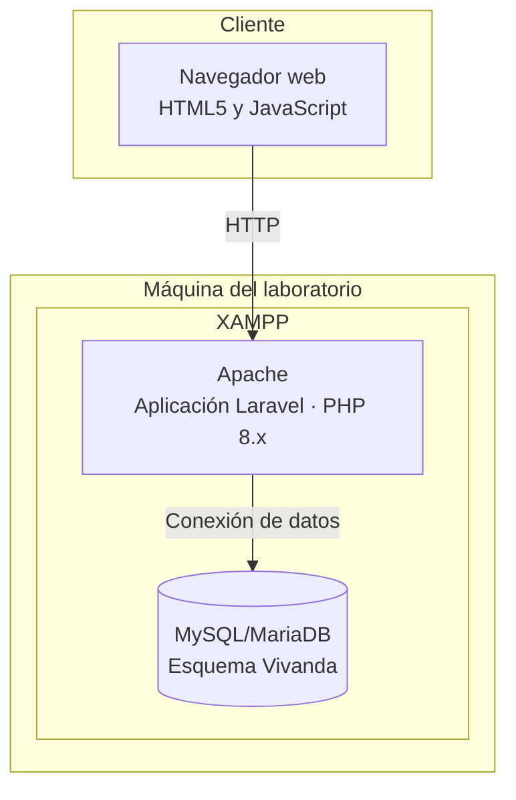
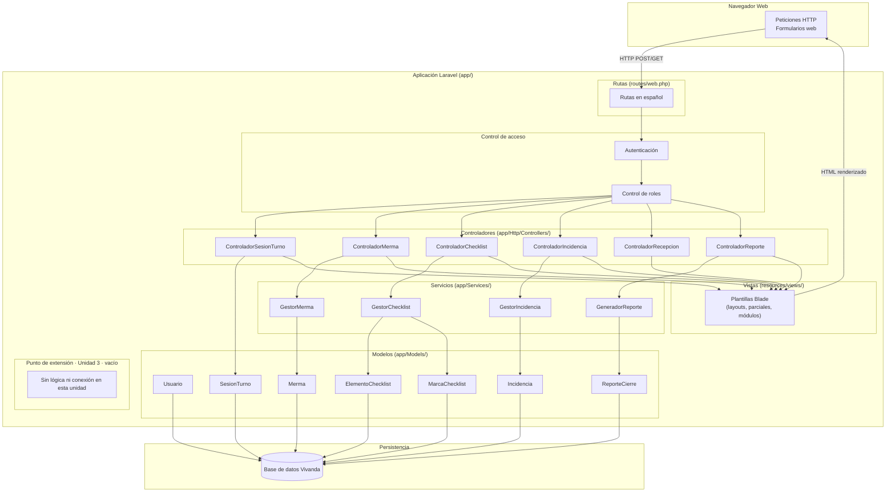
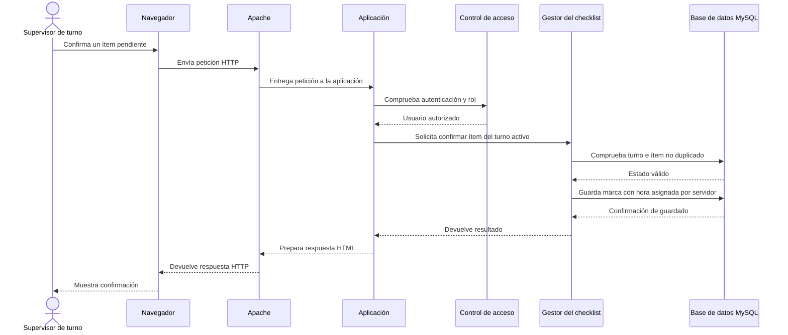
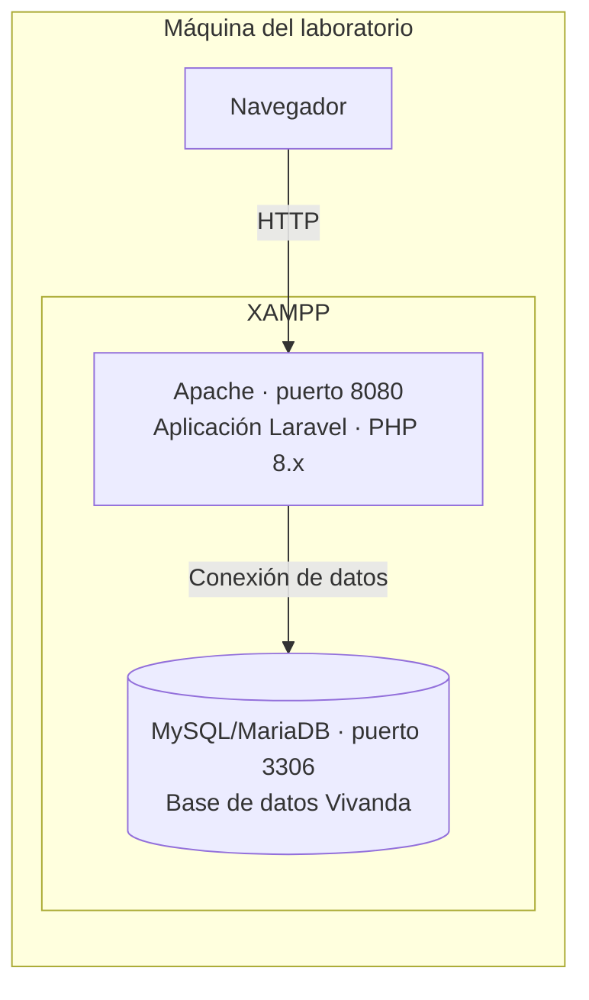

# Documento de Diseño: Asistente de Operaciones para Tienda Vivanda

## Resumen

El sistema es una aplicación web MVC en capas construida sobre **Laravel** (PHP 8.x) con base de datos **MySQL/MariaDB** sobre **XAMPP**. Las vistas se renderizan en el servidor mediante plantillas **Blade**; no se emplea ningún herramienta JavaScript adicional.

Los módulos principales de esta unidad son la gestión de sesión de turno y autenticación, el registro de mermas e incidencias, la validación de checklists y la generación del reporte de cierre. La verificación de recepción y las consultas que requieren sistemas externos quedan como funciones futuras. La interfaz conversacional, los modelos de IA y MCP están fuera del alcance de esta semana. La arquitectura solo deja señalado un punto de extensión vacío para la Unidad 3. Todo dato de trabajador es simulado conforme a la Ley N.° 29733.

**Contexto técnico de esta entrega:** PHP 8.x, Laravel, MySQL/MariaDB y XAMPP, según la consigna de la actividad. Antes de aprobar este documento, el equipo debe alinear .kiro/steering/tech.md y la especificación con esta decisión: actualmente tech.md describe Python/FastAPI/SQLite y requirements.md declara SQLite en su glosario. Hasta resolver esa discrepancia, el criterio 8 del checklist queda pendiente de validación.

---

## Arquitectura

### Diagrama C4 Nivel 2 — Contenedores

Este diagrama muestra los contenedores previstos para la unidad actual. El agente y el servidor MCP no forman parte del despliegue de esta semana.

---

### Diagrama C4 Nivel 3 – Componentes

---

### Diagrama de secuencia — Validación de checklist

**Caso de uso:** el supervisor confirma un ítem del checklist de apertura (Req. 3).

Si el usuario carece de autorización, no tiene un turno activo o el ítem ya fue validado, la aplicación rechaza la operación y no modifica el registro existente (Req. 3.4 y 3.7).

---

### Diagrama de despliegue

El despliegue representa únicamente la máquina del laboratorio con XAMPP y el navegador. No se incorporan nube, contenedores ni el despliegue de componentes de la Unidad 3.

---

## Componentes e interfaces

### Tabla de componentes y trazabilidad

| Componente del N3 | Responsabilidad | Ubicación prevista | Historia o requisito trazado |
|---|---|---|---|
| Navegador (BROWSER) | Presentar pantallas y enviar solicitudes del personal | Cliente web | Req. 1 |
| Rutas web (WEB) | Recibir solicitudes y dirigirlas a la función correspondiente | routes/web.php | Req. 1–8 |
| Autenticación (AUTH) | Validar credenciales y establecer la sesión del usuario | Módulo de acceso | Req. 7 |
| Control de roles (ROLE) | Restringir el acceso según el rol definido | Módulo de acceso | Req. 7; regla de acceso por rol en product.md |
| ControladorSesionTurno (SC) | Iniciar y cerrar el turno asociado al usuario | Controladores | Req. 7 |
| ControladorMerma (MC) | Recibir y validar registros de merma | Controladores | Req. 2 |
| ControladorChecklist (CC) | Consultar checklist y recibir confirmaciones | Controladores | Req. 3 |
| ControladorIncidencia (IC) | Recibir y validar incidencias | Controladores | Req. 8 |
| ControladorRecepcion (RC) | Mostrar que la verificación no está disponible esta unidad | Controladores | Req. 4; función externa futura |
| ControladorReporte (RPT) | Solicitar generación o recuperación del reporte | Controladores | Req. 6 |
| GestorMerma (GMS) | Validar datos y guardar mermas | Servicios | Req. 2 |
| GestorChecklist (GCS) | Validar turno, duplicados y hora de confirmación | Servicios | Req. 3 |
| GestorIncidencia (GIS) | Validar descripción, categoría y turno | Servicios | Req. 8 |
| GeneradorReporte (GRS) | Consolidar y guardar el reporte del turno | Servicios | Req. 6 |
| Usuario (USR) | Representar personal con datos simulados | Modelos | Req. 7 y Req. 10 |
| SesionTurno (ST) | Representar el turno y su estado | Modelos | Req. 7 |
| Merma (MRM) | Representar un registro de producto dado de baja | Modelos | Req. 2 |
| ElementoChecklist (IC2) | Representar una tarea de apertura o cierre | Modelos | Req. 3 |
| MarcaChecklist (MRC) | Representar la confirmación de un elemento | Modelos | Req. 3 |
| Incidencia (INC) | Representar una incidencia operativa | Modelos | Req. 8 |
| ReporteCierre (RPT2) | Asociar el reporte al turno correspondiente | Modelos | Req. 6 |
| Plantillas web (BLADE) | Presentar formularios, estados, confirmaciones y reportes | resources/views/ | Req. 1–8 |
| Base de datos (DB) | Guardar usuarios simulados y registros operativos | MySQL/MariaDB | Req. 2, Req. 3, Req. 6, Req. 7, Req. 8 y Req. 10 |
| Punto de extensión vacío (EXT) | Reservar ubicación sin comportamiento esta semana | app/asistente/ | Req. 1 como capacidad futura; no se implementa ahora |

**Criterio de trazabilidad:** cada componente del N3 está identificado individualmente y vinculado a una historia o requisito. La extensión se marca como futura y vacía; no constituye una función entregada.

---

### Punto de extensión futuro — Unidad 3

Se reserva la carpeta app/asistente/ como punto de extensión para la Unidad 3. Durante esta unidad permanece vacía: no se crea controlador, lógica conversacional, modelo de IA, conexión MCP ni llamadas a servicios. La ubicación señala únicamente dónde podrá evaluarse una integración futura, una vez que el equipo la diseñe y apruebe.

La verificación de recepción y las consultas que dependen de sistemas externos se muestran como no disponibles en esta unidad. Aquí no se definen su protocolo, flujo, componentes internos ni implementación.

---

## Modelo de datos

Los modelos Laravel declarados a continuación usan `protected $table` explícito para respetar la convención de nombres en español y singular. El motor de tablas es InnoDB con collation `utf8mb4_unicode_ci`. El esquema completo de columnas, claves foráneas e índices se gestiona mediante migraciones y se documenta en `docs/arquitectura/modelo_datos.md`.

| Modelo Laravel | Tabla MySQL | Columnas principales | Relaciones |
|---|---|---|---|
| `Usuario` | `usuario` | `id`, `nombre`, `rol` (enum), `password` (hash), `activo` | varios registros relacionados SesionTurno, MarcaChecklist, Merma, Incidencia |
| `SesionTurno` | `sesion_turno` | `id`, `usuario_id`, `inicio_en` (servidor), `cierre_en` (servidor), `estado` | pertenece a Usuario; varios registros relacionados MarcaChecklist, Merma, Incidencia; un registro relacionado ReporteCierre |
| `ElementoChecklist` | `elemento_checklist` | `id`, `descripcion`, `tipo` (apertura/cierre), `orden` | varios registros relacionados MarcaChecklist |
| `MarcaChecklist` | `marca_checklist` | `id`, `elemento_checklist_id`, `sesion_turno_id`, `usuario_id`, `completado_en` (servidor) | pertenece a ElementoChecklist, SesionTurno, Usuario |
| `Merma` | `merma` | `id`, `sesion_turno_id`, `usuario_id`, `codigo_producto`, `cantidad` (entero positivo), `motivo`, `registrado_en` (servidor) | pertenece a SesionTurno, Usuario |
| `Incidencia` | `incidencia` | `id`, `sesion_turno_id`, `usuario_id`, `categoria`, `descripcion`, `registrado_en` (servidor) | pertenece a SesionTurno, Usuario |
| `ReporteCierre` | `reporte_cierre` | `id`, `sesion_turno_id`, `porcentaje_cumplimiento`, `resumen_mermas`, `resumen_incidencias`, `generado_en` (servidor) | pertenece a SesionTurno |

**Reglas de integridad aplicadas en migraciones:**

- `completado_en`, `registrado_en` y `generado_en` los asigna el servidor (`now()`); el cliente nunca puede enviarlos ni modificarlos.
- El campo `rol` de `Usuario` acepta únicamente los valores: `jefe_tienda`, `supervisor_turno`, `reponedor`, `encargado_recepcion`.
- El campo `categoria` de `Incidencia` acepta únicamente las categorías del catálogo definido en los requisitos.
- No se almacenan DNI, teléfono ni correo electrónico del personal (Ley N.° 29733).
- Las contraseñas se almacenan con hash bcrypt mediante el sistema de autenticación de Laravel.

---

## Propiedades de corrección

*Una propiedad es una característica o comportamiento que debe cumplirse en todas las ejecuciones válidas del sistema: es decir, una afirmación formal sobre lo que el sistema debe hacer. Las propiedades sirven de puente entre las especificaciones legibles por personas y las garantías de corrección verificables por máquina.*

Esta función involucra principalmente operaciones CRUD con reglas de negocio bien definidas, validaciones de fronteras discretas y persistencia en MySQL. Las operaciones centrales no son funciones puras con un espacio de entrada arbitrario, por lo que las propiedades se formulan como invariantes de estado y restricciones de integridad que deben mantenerse en toda ejecución.

### Propiedad 1: Marca de tiempo asignada por el servidor

*Para cualquier* registro de marca de checklist, merma o incidencia almacenado en la base de datos, el campo de fecha-hora (`completado_en`, `registrado_en`) debe ser igual al instante en que el servidor procesó la solicitud, nunca a un valor enviado por el cliente.

**Valida: Requisito 3 (checklist), Requisito 2 (mermas), Requisito 8 (incidencias)**

---

### Propiedad 2: Unicidad de marca de checklist por turno

*Para cualquier* par `(elemento_checklist_id, sesion_turno_id)`, la tabla `marca_checklist` no debe contener más de un registro con esa combinación: confirmar un ítem ya confirmado debe ser rechazado sin modificar la base de datos.

**Valida: Requisito 3.7**

---

### Propiedad 3: Acciones bloqueadas sin turno activo

*Para cualquier* operación de registro (merma, marca de checklist, incidencia), si no existe ninguna `SesionTurno` con estado activo para el usuario autenticado, la operación debe ser rechazada y la base de datos debe quedar sin cambios.

**Valida: Requisito 3.4, Requisito 2 (mermas sin turno), Requisito 8.7**

---

### Propiedad 4: Control de acceso por rol

*Para cualquier* ruta protegida del sistema, un usuario autenticado con rol distinto al requerido debe recibir un error de autorización y no debe poder leer ni modificar datos que no corresponden a su rol.

**Valida: Requisito 9, Requisito 10**

---

### Propiedad 5: Cantidad de merma siempre entero positivo

*Para cualquier* valor de cantidad enviado al registrar una merma, solo debe persistirse si es un entero estrictamente mayor que cero; cualquier valor igual a cero, negativo o decimal debe ser rechazado sin guardar registro.

**Valida: Requisito 2.5**

---

### Propiedad 6: Categoría de incidencia dentro del catálogo

*Para cualquier* registro de incidencia, la categoría almacenada debe pertenecer al conjunto de categorías válidas definido en el sistema; toda categoría fuera de ese conjunto debe ser rechazada.

**Valida: Requisito 8.4**

---

## Manejo de errores

| Situación | Respuesta del sistema |
|---|---|
| Credenciales inválidas al iniciar sesión | Mensaje de error en vista Blade; sin redirección a detalles internos (Req. 7.2) |
| Acción sin turno activo | Rechazo con mensaje descriptivo; sin modificar la BD (Req. 3.4, 7.5, 8.7) |
| Código de producto inexistente al registrar merma | Rechazo con mensaje; sin guardar registro (Req. 2.3) |
| Cantidad de merma no válida (no entero positivo) | Rechazo con mensaje de validación (Req. 2.5) |
| Ítem de checklist ya confirmado | Rechazo sin modificar el registro existente (Req. 3.7) |
| Descripción de incidencia fuera de rango | Rechazo con indicación del rango válido (Req. 8.3) |
| Categoría de incidencia inválida | Rechazo con lista de categorías válidas (Req. 8.4) |
| BD no puede almacenar el reporte de cierre | Mensaje de error al usuario; reporte disponible en pantalla durante la sesión (Req. 6.4) |
| Reporte solicitado para turno inexistente | Mensaje de error; sin generar reporte (Req. 6.7) |
| Consulta externa no disponible | Fuera de alcance esta unidad; se definirá al diseñar la integración futura (Req. 1.6) |

Todos los errores de validación se gestionan mediante el sistema de validación de Laravel (`FormRequest` o `Validator`). Los errores de lógica de negocio se propagan como excepciones personalizadas desde la capa de servicios y se capturan en el controlador para presentar la vista de error correspondiente.

---

## Estrategia de pruebas

Esta función involucra principalmente operaciones CRUD con reglas de negocio sobre una arquitectura MVC con vistas Blade y persistencia en MySQL. Las operaciones centrales no son funciones puras con un espacio de entrada arbitrario; su corrección depende del estado de la base de datos y de las validaciones de negocio con reglas discretas y bien definidas. Por este motivo, **las pruebas basadas en propiedades (PBT) no aplican** a este feature: las reglas de validación tienen fronteras fijas (ej. cantidad > 0, descripción entre 10 y 1000 caracteres, cinco categorías exactas) que se cubren mejor con pruebas de ejemplo y casos límite.

### Pruebas unitarias

Cubren la lógica de negocio en la capa de servicios de forma aislada, con base de datos en memoria o dobles de prueba.

| Servicio | Casos de prueba prioritarios |
|---|---|
| `GestorMerma` | Registro exitoso; cantidad = 0 rechazada; cantidad negativa rechazada; cantidad decimal rechazada; código de producto inexistente rechazado; merma sin turno activo rechazada |
| `GestorChecklist` | Confirmación exitosa con fecha y hora del servidor; ítem ya confirmado rechazado; confirmación sin turno activo rechazada; la fecha y hora nunca proviene del cliente |
| `GestorIncidencia` | Registro exitoso; descripción < 10 chars rechazada; descripción > 1000 chars rechazada; categoría fuera de lista rechazada; registro sin turno activo rechazado |
| `GeneradorReporte` | Reporte con mermas e incidencias; reporte para turno sin eventos; recuperación de reporte ya almacenado; error de BD manejado |

### Pruebas de integración

Cubren el flujo HTTP completo: petición → middleware → controlador → servicio → BD → respuesta Blade.

- Flujo completo de inicio y cierre de sesión de turno
- Flujo completo de registro de merma (ruta POST → BD → confirmación)
- Flujo completo de confirmación de ítem de checklist (caso exitoso y caso duplicado)
- Flujo completo de registro de incidencia
- Generación y persistencia del reporte de cierre de turno
- Redirección a login cuando el middleware rechaza una petición sin sesión
- Control de acceso por rol: cada ruta solo accesible para el rol permitido

### Casos límite que deben cubrirse

- Mensaje de 1 carácter (inválido) y de 1000 caracteres exactos (válido) para incidencias
- Cantidad de merma = 1 (mínimo válido) y = 0 (inválido)
- Búsqueda de producto con término de 1 carácter (inválida) y de 2 caracteres (válida)
- Inicio de sesión cuando ya existe una sesión activa para el mismo usuario
- Solicitud de reporte para turno sin ningún evento registrado

---

## Decisiones pendientes

Las siguientes decisiones se delegan al diseño detallado o a la implementación del equipo:

- **Versión de Laravel**: instalar la versión estable vigente compatible con el PHP 8.x de XAMPP; verificar el entorno antes de la semana 7.
- **Diseño detallado de la interfaz de usuario**: wireframes y estilos CSS específicos de cada vista Blade.
- **Esquema completo de la base de datos**: columnas, claves foráneas, índices y migraciones se documentan en `docs/arquitectura/modelo_datos.md` (ADR-002, pendiente).
- **Estrategia de cargas iniciales para datos simulados**: cómo se poblarán usuarios, ítems de checklist y productos de prueba.
- **Configuración del host virtual de Apache**: mapeo de `public/` como raíz web en cada máquina del equipo.
- **Autorización por roles**: definir si se usarán controles nativos del framework o una tabla de roles propia.
- **Conexión, protocolo y diseño del componente agente**: todo lo relativo a la integración del asistente conversacional y del Servidor MCP queda para la Unidad 3.
